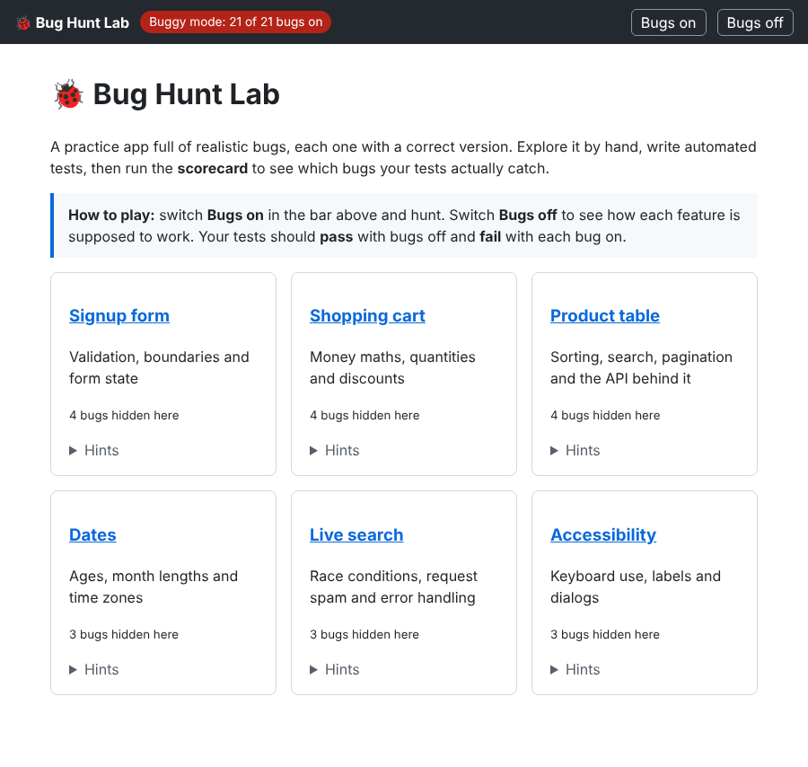
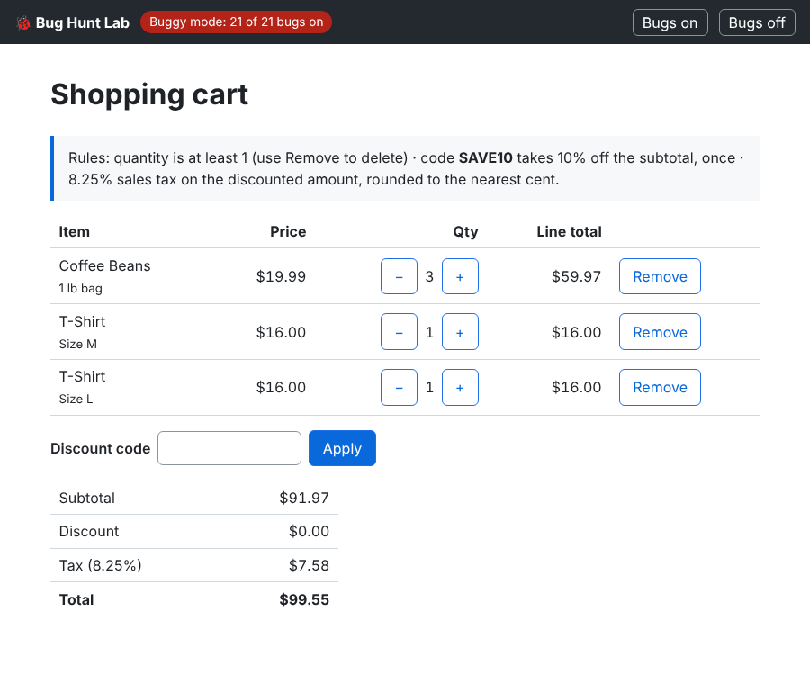

# Bug Hunt Lab


**A QA practice app with 21 realistic bugs. Each one can be switched on and off, and a scorecard shows exactly which of them your tests catch.**

Every feature has a correct version and a buggy version. Explore it by hand, write automated tests against the correct version, then let the scorecard switch each bug on, one at a time, and run your suite against it. If your tests stay green while a bug is on, that bug got past you.

```
$ npm run scorecard -- --tests solutions/e2e

Baseline (all bugs off)... 53 tests pass. ✓

✅ caught  SIGNUP-1  (4 failing)
✅ caught  CART-1    (2 failing)
✅ caught  DATES-3   (2 failing)
✅ caught  SEARCH-1  (1 failing)
...
Score: 21/21 bugs caught (100%)
```

<p align="center"> </p>
<p align="center"><sub>Right: the cart with bugs on. Can you spot why $7.58 is wrong?</sub></p>

## The challenges

| Challenge | Bugs | What you'll practice |
|---|:-:|---|
| **Signup form** | 4 | Validation, boundary values, form state, double submits |
| **Shopping cart** | 4 | Money maths to the cent, quantity limits, discount rules, item identity |
| **Product table** | 4 | Sorting, case-insensitive search, pagination, API testing with bad input |
| **Dates** | 3 | Birthdays, month-end and leap years, **time zones** |
| **Live search** | 3 | **Race conditions**, request debouncing, error handling |
| **Accessibility** | 3 | Keyboard-only use, labels, dialog focus management |

The bugs are the kind that reach production: an off-by-one at a boundary, a tax rounded down instead of to the nearest cent, a date that shows the day before for everyone west of London, a slow response overwriting a newer one. The hints are in the app, and the full answers are in [`spoilers/BUGS.md`](spoilers/BUGS.md).

## Quickstart

```bash
npm install
npx playwright install chromium
npm start                 # http://localhost:3000, all bugs off
```

Use **Bugs on** and **Bugs off** in the top bar to switch modes while you explore. To start with specific bugs:

```bash
BUGS=all npm start
BUGS=CART-1,DATES-3 npm start
```

On Windows PowerShell: `$env:BUGS="all"; npm start`

## Practice loop

1. **Explore.** Use the app with bugs off to learn how it should work, then turn bugs on and find what's broken.
2. **Write tests** in `tests/`. There's a starter file to begin from.
3. **Check for false alarms:** `npm test` runs your tests against the correct app, and they must pass.
4. **Score yourself:** `npm run scorecard` runs your suite once per bug and lists what you caught and missed, with a hint for each miss.
5. **Compare** with the reference suite in `solutions/` when you're done.

## How the scorecard works

This is [mutation testing](https://en.wikipedia.org/wiki/Mutation_testing), with hand-written, realistic bugs in place of random code changes:

1. Runs your suite with every bug **off**. Any failure here is a false alarm, so the scorecard stops and lists the failing tests.
2. Starts a fresh server for each bug with **only that bug on**, and runs your suite against it.
3. A bug counts as **caught** if at least one test fails **consistently**. Every failing test is retried once. A real bug fails both times, but a test that only failed because of a timing hiccup passes on the retry, gets reported as flaky, and doesn't count. Without this, a slow machine could score points by timing out.

CI runs the scorecard against the reference suite with `--min-score 100`. That proves every bug in the lab is real, observable and catchable, and keeps it that way as the code changes.

## What's in the box

```
app/server.mjs        Zero-dependency Node server + JSON API (signup, products, search)
app/bugs.json         The bug registry: id, challenge, category, difficulty, hint
public/lib/           Shared logic with correct and buggy paths (used by browser AND server)
public/js/            One script per challenge page
solutions/e2e/        Reference Playwright suite: 53 tests, catches 21/21
solutions/unit/       Reference unit tests (node:test, no dependencies): 30 tests
tests/                Your tests go here
scripts/scorecard.mjs The per-bug scoring runner
spoilers/BUGS.md      Every bug explained: what, why it happens in real code, how to catch it
```

## Techniques shown in the reference suite

- **Boundary-value analysis:** passwords of 7, 8 and 9 characters; quantity at 1; month-end dates.
- **Equivalence classes:** tables of invalid emails and invalid API parameters.
- **Network assertions:** counting requests to catch double submits and missing debounce.
- **Race-condition testing:** forcing out-of-order responses, then waiting for the stale response before asserting.
- **Time zone testing:** the same test in Denver, Honolulu, Tokyo and UTC with `test.use({ timezoneId })`.
- **API testing below the UI:** sending values the UI never would.
- **Accessibility:** axe-core scans plus keyboard-only flows and focus checks, which automated scanners miss.
- **The test pyramid:** pure logic is unit tested in milliseconds, and the e2e suite checks the same rules through the real UI.

## Design decisions

- **One shared code path per rule.** Each rule lives in `public/lib/` with a `bug(id)` switch, and the browser and server import the same file. The correct and buggy versions sit side by side, so the diff for each bug is a few lines.
- **Bugs are independent.** Each one can be switched on alone, and the scorecard relies on that. CI checks that each bug, on its own, breaks at least one reference test.
- **Deterministic by design.** The search API delays short queries on purpose, so the race condition reproduces every time instead of "sometimes on slow networks".
- **No retries in normal runs.** A lab about finding bugs shouldn't hide them. Retries exist only inside the scorecard, to tell real catches from noise.
- **Zero runtime dependencies.** The server uses only Node built-ins, and it blocks path traversal so it only ever serves files from `public/`.

## License

MIT
